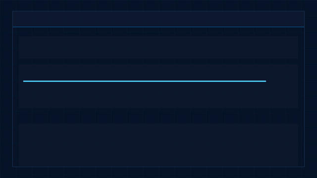

# repomark

**Know what your repository can prove before someone else has to inspect it.**

repomark is an offline CLI for evidence-first repository readiness and regression checks. It scans local files and Git metadata, scores visible signals, shows the paths behind each result, and gives concrete follow-up actions. No network. No credentials. No popularity theater.



## Why repomark

README, license, CI, tests, source, docs, package metadata, and recent activity are easy to overlook. repomark turns those signals into one repeatable report that works on a laptop or in CI.

- **Evidence first:** every check lists detected local paths, or says `none`.
- **Offline by design:** selected files and local Git metadata stay on your machine.
- **Regression aware:** save JSON once, then use `--compare` to spot score movement, regressions, recoveries, changed evidence, and finding changes.
- **Useful outputs:** terminal for review, Markdown for summaries, HTML for sharing, JSON for automation, and SVG for a small status badge.

## Quick start

Requires Node.js 20 or newer.

```sh
npx repomark .
```

Install it into a project:

```sh
npm install --save-dev repomark
npx repomark . --format markdown --output reports/repomark.md
```

Run source checkout commands:

```sh
npm install
npm run build
node dist/src/cli.js . --format terminal --no-color
```

## Read the result

The score is a heuristic readiness signal, not a security audit, code quality rating, or popularity measure. Fixed weighted checks add up to 100 points. A passing signal means repomark found the local evidence its rule expects. A missing signal earns zero and appears with an action.

```text
PASS README            15/15
  Evidence: README.md
MISS Recent activity    0/10
  Evidence: none
```

Before: a repository review starts with scattered questions about whether basic project signals exist.

After: one report names the missing signal, shows what was found, and points to the next action. The exact score depends on repository contents and local Git history, so examples should be read as shape, not a promise of a fixed grade.

## Commands and options

```text
repomark [path] [options]

  --format terminal|json|html|markdown|badge
  --output file          Write primary report to file
  --badge-output file    Write SVG badge alongside primary report
  --compare file         Compare current report with a JSON ScoreReport
  --threshold 0..100     Exit 1 when score is below value
  --no-color             Disable terminal color
  --help                 Show help
  --version              Show version
```

`path` defaults to `.`. Only one repository path is allowed. `--compare` accepts JSON produced by `--format json`, including legacy reports without `contract`, for example:

```sh
repomark . --format json --output baseline.json
repomark . --format markdown --output reports/current.md --compare baseline.json
```

Exit codes:

| Code | Meaning |
| ---: | --- |
| 0 | Report generated, threshold met or not requested |
| 1 | Report generated, score below `--threshold` |
| 2 | Invalid CLI usage |
| 3 | Repository scan or output failure |

## Output formats

| Format | Best for | Includes |
| --- | --- | --- |
| `terminal` | Local review and CI logs | Score, grade, readiness count, evidence, findings, diagnostics, comparison summary |
| `markdown` | Job summaries and pull request notes | Shareable score table, evidence, findings, diagnostics, comparison summary |
| `html` | Browser review | Self-contained report with score, evidence, findings, diagnostics, comparison summary |
| `json` | Scripts and baselines | Additive `ScoreReport`, including facts, provenance, findings, `generatedAt`, optional `contract`, `status`, and comparison metadata |
| `badge` | README status | 190x20 SVG with score and grade |

Use `--output` to write any primary format. Use `--badge-output` to create a badge alongside it.

JSON reports keep the existing root fields and add optional metadata. `contract` identifies the report as `repomark` version `1`; `status` records `passed`, `exitCode`, and `threshold` when a threshold was evaluated. Scanner provenance includes `diagnostics` with file/depth limits, limit causes, unreadable directory count, and unreadable file paths. Comparison metadata includes `compatibility` (`compatible`, `legacy`, or `incompatible`), `diagnosticsChanged`, and the baseline source when supplied. Reports without `contract` remain valid legacy baselines. These fields do not change scoring, grade thresholds, badge output, or exit semantics.

## Scoring model

| Signal | Points |
| --- | ---: |
| README | 15 |
| License | 10 |
| `.gitignore` | 5 |
| CI | 15 |
| Tests | 15 |
| Package metadata | 10 |
| Source | 10 |
| Docs | 10 |
| Recent activity | 10 |

Grades are A at 90+, B at 75+, C at 60+, D at 40+, and F below 40. Weights and exit semantics are fixed. The score reflects detectable repository signals, not correctness, maintainability, vulnerability status, or user adoption. Recent activity depends on local Git history. Traversal skips common generated and dependency directories and uses fixed file and depth limits; reports expose when those limits or unreadable files affect evidence.

## CI integration

The repository includes a scheduled workflow pattern in `.github/workflows/repomark.yml`. It runs locally on the GitHub-hosted runner, writes Markdown, JSON, and HTML reports, adds Markdown to the job summary, and uploads reports as artifacts. It needs no secrets and makes no runtime network request from repomark itself.

For a project workflow, the core pattern is:

```yaml
- run: npm ci
- run: npm run build
- run: node dist/src/cli.js . --format markdown --output repomark.md
- run: node dist/src/cli.js . --format json --output repomark.json
- run: node dist/src/cli.js . --format html --output repomark.html
- if: always()
  uses: actions/upload-artifact@v4
  with:
    name: repomark-reports
    path: repomark.*
```

Add `--threshold 75` when a readiness floor should affect job status. Treat code 1 as a reported threshold result, not a scanner crash.

## Demo assets

The GIF near the top is generated from real local terminal output. To regenerate MP4 and GIF on Windows, install `ffmpeg` and run:

```powershell
powershell -NoProfile -ExecutionPolicy Bypass -File .\scripts\demo-video.ps1
```

The script captures `node dist/src/cli.js . --format terminal --no-color` before rendering, so visible scores and findings follow the current CLI.

## Privacy and limitations

repomark reads the selected directory and local Git metadata only. It does not send files, call APIs, or add network runtime behavior. It cannot judge whether code works, whether a dependency is safe, whether documentation is accurate, or whether a project is popular. It reports common visible signals and their evidence. Review findings in context.

## Development

```sh
npm install
npm test
npm run check
npm run smoke
npm run pack:check
```

Contributions should preserve deterministic scoring, output escaping, badge dimensions, zero runtime dependencies, and documented CLI behavior. See [CONTRIBUTING.md](CONTRIBUTING.md) and [SECURITY.md](SECURITY.md).

Licensed under [MIT](LICENSE).
